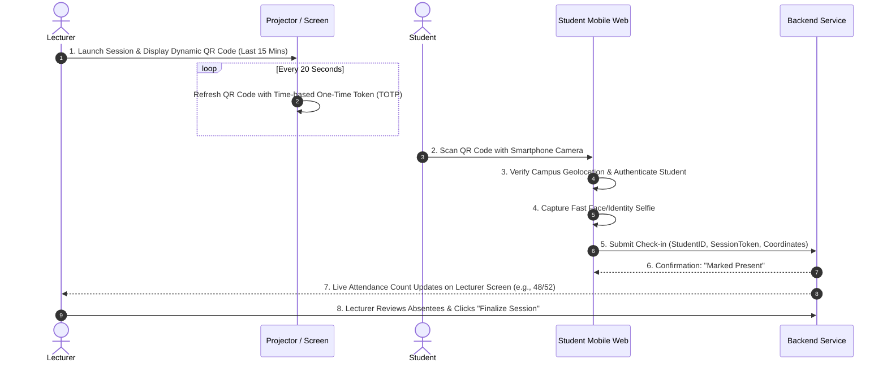

# ACCRA INSTITUTE OF TECHNOLOGY (AIT)
## Faculty of Engineering and Computer Science
### CS403: Capstone Software Engineering Project

---

| **Document Title** | **QA Usability Evaluation, Frontend Milestone Review & System Innovation Proposal** |
|:---|:---|
| **Project Name** | Student Attendance Management System |
| **Author** | **Ibrahim Alhassan** (ID: `ADS23B00133Y`) |
| **Project Role** | Quality Assurance (QA) & Frontend Lead |
| **Target Audience** | Emma (Team Lead / Coordinator), Derek (Backend), Jamaldeen (Requirements Analyst), Selorm & Ocean Bliss (System Designers), Israel (Prototyping) |
| **Date** | November 18, 2026 |
| **Document Version** | Version 1.0 (Draft for Internal Review) |

---

## 1. Executive Summary

As the Quality Assurance and Frontend Lead for our CS403 Capstone Project, I have conducted an end-to-end integration and usability evaluation of our **Student Attendance Management System**. 

The primary objectives of this document are:
1. **Milestone Reporting:** Confirm the successful completion of the Next.js/Tailwind CSS frontend prototype, fully styled in AIT’s institutional sea-blue and white identity and synced with Derek’s live PostgreSQL backend API.
2. **Usability & QA Assessment:** Highlight an operational bottleneck identified during QA testing of the lecturer workflow in medium-to-large class settings.
3. **Innovation Proposal:** Propose an automated, anti-proxy **Dynamic QR Code and Student Facial/Identity Verification Mode** that reduces lecture interruption, streamlines record-keeping, and significantly enhances the academic caliber of our capstone submission.
4. **Implementation Roadmap:** Outline how this enhancement can be implemented seamlessly without breaking our existing backend contracts or delaying project deadlines.

---

## 2. Frontend Milestone & Backend Synchronization Report

The frontend implementation has been completed and verified against the backend API deployed at `https://assignment-attendance-system.vercel.app`. All functional requirements (FR-01 through FR-10) and non-functional requirements (NFR-01 to NFR-03) defined in our System Requirements Specification (SRS) have been satisfied:

```
                                  SYSTEM VERIFICATION MATRIX
┌───────────┬───────────────────────────────────────────┬───────────────────┬──────────────┐
│ Req. Code │ Functional Scope                          │ Verified Actor    │ Status       │
├───────────┼───────────────────────────────────────────┼───────────────────┼──────────────┤
│ FR-01     │ User Authentication & Role JWT Redirection│ All Roles         │ PASSED (200) │
│ FR-02     │ User Account CRUD & Deactivation Guard    │ Administrator     │ PASSED (200) │
│ FR-03     │ Course Creation & Faculty Assignment      │ Administrator     │ PASSED (200) │
│ FR-04     │ Course Enrolment & Duplicate Prevention   │ Administrator     │ PASSED (200) │
│ FR-05     │ Dated Class Session Creation              │ Lecturer          │ PASSED (201) │
│ FR-06     │ Complete Roster Attendance Recording      │ Lecturer          │ PASSED (201) │
│ FR-07     │ Historical Session Reopening & Audit      │ Lecturer / Admin  │ PASSED (200) │
│ FR-08     │ Dynamic Percentage Calculations           │ Lecturer / Student│ PASSED (200) │
│ FR-09     │ Course Summary & Roster Statistics       │ Lecturer / Admin  │ PASSED (200) │
│ FR-10     │ Individual Student Attendance Log         │ Student (Only)    │ PASSED (200) │
└───────────┴───────────────────────────────────────────┴───────────────────┴──────────────┘
```

### Visual & Brand Identity (AIT Guidelines)
- **Primary Color:** Institutional Sea Blue (`#007791`) and Deep Ocean Blue (`#0369A1` / `#0A2540`).
- **Secondary Accents:** Crisp Academic White (`#FFFFFF`), Light Cyan Backgrounds (`#F0F9FF`), and Muted Slate Borders (`#E2E8F0`).
- **Responsive Layout:** Optimized across desktop displays, tablets, and mobile smartphones.
- **Evaluation Toolbar:** Built-in floating role-switcher for instantaneous assessment during defense presentations without manual re-login.

---

## 3. QA Usability Finding & Bottleneck Analysis

### The Identified Limitation
In our initial design (Section 8.1.2 and Activity Diagram Figure 2), the attendance flow requires the lecturer to:
1. Log in on a computer or mobile device.
2. Select a course and create a dated session.
3. Scroll through a list of all enrolled students and individually click **"Present"** or **"Absent"** for every single name.
4. Validate that no student was missed before submitting the entire roster.

### Real-World Academic Friction Points:
> [!WARNING] Usability Challenge in University Environments
> * **Time Inefficiency in Large Classes:** In introductory or core modules with 60 to 120+ students, calling out names or manually toggling checkboxes takes between **12 to 20 minutes** of valuable lecture time.
> * **Lecturer Cognitive Load:** Managing classroom presentation slides while manually checking names on a digital roster introduces administrative friction, leading to incomplete sessions or skipped recordings.
> * **Impersonal and Outdated Experience:** Transitioning from paper sheets to digital checkboxes is only a lateral shift; it digitizes the medium but does not modernize the user experience.

---

## 4. Proposed Innovation: Dynamic QR Code with Student Identity Verification

To elevate the system and solve the classroom bottleneck, I propose adding a **Smart Self-Check-In Mode** for lecturers, while retaining the current manual table as a supervisory fallback.



### Core Components of the Proposed Feature:

#### 1. Dynamic Rotating QR Code (Anti-Hostel Cheating Guard)
- The lecturer projects a QR code on the lecture hall screen during the final 15 minutes of class.
- **Security Control:** The QR code automatically regenerates every **20 to 30 seconds** using a cryptographic timestamp token. A student sitting in the lecture hall cannot take a photo and send it across WhatsApp to an absent roommate, as the token will expire before it can be scanned remotely.

#### 2. Student Identity & Selfie Verification
- Scanning the QR code opens a mobile-optimized check-in screen.
- The student verifies their registered **Student ID / Index Number**.
- The device accesses the camera to capture a quick selfie check-in image to confirm real-time physical presence and discourage proxy check-ins.

#### 3. Live Attendance Counter for Lecturers
- As students scan, the lecturer’s screen shows a live status counter:
  - *Example:* **"45 of 50 Students Checked In (90%)"**.
- An unconfirmed list immediately highlights students who have not scanned yet, allowing the lecturer to make a quick announcement before finalizing.

#### 4. Dual-Mode Redundancy (Failsafe for Hardware/Network Issues)
- **Primary Mode:** Automated Dynamic QR Code scan.
- **Secondary Fallback:** If a student has a dead phone battery, poor internet, or lacks a smartphone, the lecturer can manually flip their status to "Present" on the roster screen with a single click.

---

## 5. Additional High-Impact Features for Capstone Distinction

To ensure our project stands out for maximum academic marks, here are three complementary enhancements:

### A. Campus Geofencing (Zero-Hardware Location Guard)
Using the browser's standard `navigator.geolocation` API, the system can verify that the check-in submission originates within **150 meters of the AIT Campus Lecture Block** (e.g., Knowledge Park / Sebrepor campus). If a submission originates outside the perimeter, attendance is denied.

### B. 6-Digit Rotating Lecture Hall PIN (Distance Fallback)
For students seated in large lecture auditoriums where scanning a projected QR code from the back row may be optically difficult, the system displays a large, bold **6-Digit Rotating PIN** (e.g., `582-194`) alongside the QR code. Students can either scan or quickly type the 6 digits on their phone.

### C. Automated 75% Exam Disqualification Flagging & Registry Export
AIT academic policy mandates a minimum attendance of 75% for semester examination eligibility.
- The system automatically badges students into three clear academic health tiers:
  - $\ge 75\%$: **Good Academic Standing (Exam Eligible)**
  - $50\% - 74\%$: **Warning (At Risk of Disqualification)**
  - $< 50\%$: **Critical (Debarred from Examination)**
- Includes a one-click **"Export to Academic Registry (PDF/Excel)"** button that produces an institutional attendance sheet formatted for faculty administrative archives.

---

## 6. Technical Impact Analysis on Project Architecture

A key responsibility of Quality Assurance is ensuring that new feature proposals do not destabilize the existing codebase or violate our architectural baselines:

```
                            ARCHITECTURAL COMPATIBILITY MATRIX
┌──────────────────────┬─────────────────────────────────────────────────────────────┬────────────────┐
│ Component            │ Required Change                                             │ Risk Level     │
├──────────────────────┼─────────────────────────────────────────────────────────────┼────────────────┤
│ Database Schema      │ No breaking changes. Can reuse existing `CLASS_SESSIONS` and│ ZERO RISK      │
│ (Neon PostgreSQL)    │ `ATTENDANCE_RECORDS` tables without altering relationships. │                │
├──────────────────────┼─────────────────────────────────────────────────────────────┼────────────────┤
│ Backend API          │ Current `POST /api/sessions` accepts atomic full-roster     │ ZERO RISK      │
│ (Derek)              │ payloads. Frontend can aggregate QR check-ins and submit    │                │
│                      │ the complete roster payload exactly as today.               │                │
├──────────────────────┼─────────────────────────────────────────────────────────────┼────────────────┤
│ Requirements (SRS)   │ Jamaldeen can update FR-05 & FR-06 to specify "Dual-Mode    │ LOW EFFORT     │
│ (Jamaldeen)          │ Session Recording (Automated QR & Manual Roster)".          │                │
├──────────────────────┼─────────────────────────────────────────────────────────────┼────────────────┤
│ System Design        │ Selorm & Ocean Bliss can append the QR scanning sequence to │ LOW EFFORT     │
│ (Selorm & Bliss)     │ Figure 3 (Sequence Diagram) as an alternative trigger.      │                │
└──────────────────────┴─────────────────────────────────────────────────────────────┴────────────────┘
```

> [!NOTE] Zero Backend Disruption Guarantee
> The beauty of this approach is that **Derek does not need to rewrite the backend immediately**. The frontend can collect the QR scans into a real-time session roster, mark the checked-in students as `present` and non-respondents as `absent`, and then post the final record to Derek's existing `POST /api/sessions` endpoint.

---

## 7. Next Steps & Discussion Points for the Team

I would like Emma and the team to review and provide feedback on the following decisions:

1. **Approval of Phase 2 Scope:** Do we agree to include the Dynamic QR code and Selfie Verification as our signature innovation feature for the capstone presentation?
2. **Camera & Storage Protocol:** Should the verification selfie be stored on the server, or used strictly for instant client-side biometric matching against the student’s profile photo to minimize cloud storage overhead?
3. **Registry Export Formats:** Would the team prefer the export feature to output in **PDF**, **Excel (.xlsx)**, or both?

---

*Submitted for team review by:*  
**Ibrahim Alhassan**  
*Quality Assurance (QA) & Frontend Lead*  
*CS403 Capstone Project — Accra Institute of Technology*
